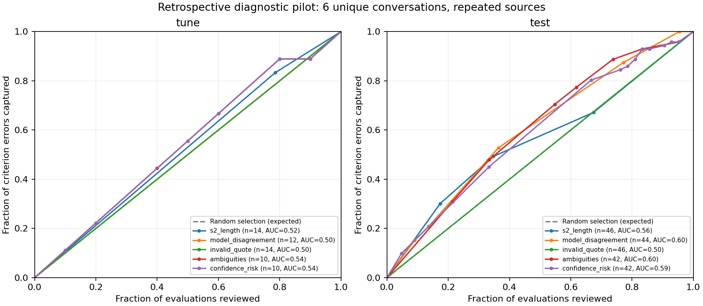

# Codex — результат спринта 1

Дата: 07.11.2026. Зона изменений: variants/codex и docs/team/variants. Материалы организаторов, общий results/, ядро платформы и чужие изменения не редактировались. Новые LLM-прогоны в этом спринте не выполнялись: подготовлены ручные пакеты.

## Итог по заданиям

| Задание | Результат | Статус |
|---|---|---|
| Сигналы маршрутизации | 60 готовых оценок, 6 уникальных диалогов, основной dev-gold@v1; кривые, таблицы, фиксированная политика | Анализ выполнен |
| Перепроверка шкал V5 | Генератор пакета из спорных c04/c06 без использования GT при выборе; слепая лестница ступеней; совместимый ingest | Реализовано; фактический R-base пока отсутствует |
| Предварительная перепроверка | 4 диалога из sa_v1:sonnet, один пакет шкал на диалог | Только preview, 4 ручные вставки |
| Устойчивость без эталона | 2 диалога × контроль + injection / neutral_swap / typo | 8 ручных вставок, ответы ещё не получены |
| Совместимость | validated/<agent>/<id>.json с checklist, usage, answers, criteria, score; проверено через metrics.compare | Тест пройден |

## Маршрутизация: что можно показать на слайде

На общей подвыборке с доступными сигналами победитель по tune — число непустых `ambiguities` (AUC бюджетной кривой 0,539). У него то же tune-AUC, что у минимальной confidence; порядок выбора фиксирован заранее списком сигналов. Отдельный выбор среди полностью доступных на всех 60 оценках сигналов дал длину диалога, но это слабый результат (tune-AUC 0,524), а не рекомендуемое правило продукта.

Порог `ambiguities >= 6` закреплён на tune при бюджете до 50% оценок. Он выбрал 4 из 10 доступных tune-оценок и поймал 4 из 9 ошибочных меток. На test **тот же порог**, без перенастройки, выбрал 23 из 42 доступных оценок (54,8%) и поймал 50 из 71 ошибочной метки (70,4%). Это диагностическое наблюдение, не доказательство такой эффективности на новых чатах. В tune всего 2 уникальных диалога, в test — 4. Все эти диалоги изучались ещё до спринта: этот split нельзя называть новым независимым hold-out.

Доля ошибок при проверке ровно 50% — интерполяция ожидаемого случайного выбора внутри одинаковых значений сигнала; она не является реализованным результатом порога. Фиксированная политика выше использует целые блоки без такого допущения. AUC здесь — площадь «бюджет проверки → пойманные ошибки», не ROC-AUC.



| Сигнал | Что обнаружено |
|---|---|
| Расхождение моделей | На доступном test-покрытии AUC около 0,602. Требует >=2 моделей одного прогона, то есть дополнительных вызовов |
| Невалидная дословная цитата | В этих 60 результатах не встретилась; предсказательную силу проверить нельзя, AUC константы 0,5 |
| ambiguities | Слабый диагностический кандидат; многое зависит от манеры модели заполнять массив |
| insufficient_data | Поле отсутствует во всех старых ответах. Это недоступный сигнал, не отрицательный результат |
| Низкая confidence | На доступном test-покрытии AUC около 0,610, но это не основание выбирать его по test; уверенность не калибрована |
| S2 | Длина, звонок, дубли дают небольшое обогащение, но могут просто узнавать один сложный звонок |

Расчёт использует нормализованные исходные суждения, чтобы не смешивать ошибку модели и отклонение строгим валидатором. Отдельно сохранён pipeline_error_view по фактически принятым answers. Для каждого сигнала явно показано покрытие; отсутствие поля не считается отрицательной меткой. Разногласия sonnet/sonnet2 не считаются панелью двух моделей. Расхождения разных архитектур не используются как «разногласие моделей» одного прогона.

Ошибки считаются по критериям против человеческого эталона, включая пропуски, а не по совпадению итогового балла или качеству объяснения. Проверка диалога предполагает просмотр всех критериев. 60 наблюдений повторяют шесть диалогов и не являются 60 независимыми случаями. Использованы все обнаруженные завершённые источники sa_*, exp_* и собственные isolated-*; точный перечень и хеши входов находятся в analysis.json. Каталог источников фиксируется при запуске, появившиеся позднее результаты требуют нового отчёта.

Артефакты:

- `variants/codex/artifacts/sprint1-routing-v2/REPORT.md` — подробная сводка.
- `analysis.json` — сигналы, кривые tune/test/all, кривые по источникам, хеши входов.
- `rows.json`, `curves.csv` — исходные наблюдения и пороговые точки.
- `fixed-policy.json` — выбор порога на tune и его неизменённая проверка на test.
- `routing-curves.png`, `.svg`, `.pdf` — рисунок для просмотра и экспорта.

Воспроизведение в новую папку:

```bash
python3 -m variants.codex.sprint1 --out variants/codex/artifacts/sprint1-routing-new
```

Для графиков нужен matplotlib; вычисление остальных частей использует стандартную библиотеку и ядро. Старый отчёт не перезаписывается. В спорном вопросе источников сравнение с GPT-помощником в разметке может быть благоприятнее для GPT-моделей; повторные источники также смещают агрегированную статистику.

## Перепроверка шкал: R-recheck

В коде нет зашитых формулировок критериев: их список задан в sprint1-packets.json, типы и ступени берутся из закреплённого чек-листа. Для нового критерия генератор работает тем же способом. В промпте — только выбранные спорные шкалы, весь исходный диалог, общие правила и инструкция проверять ступени сверху вниз, указывая нарушенное условие, дословную цитату и отличие от соседних ступеней. Эталон и исходный ответ модели в промпт не передаются.

Спорность определяется без GT: расхождение исходных ответов, ambiguity, insufficient_data, низкая confidence или замечания валидатора. Выбирается не более 10 диалогов, по одному запросу на диалог с обеими спорными шкалами при необходимости. Пустой маршрут не создаёт фиктивных LLM-заданий. Список из 10 — верхний бюджет, а не квота, которую нужно заполнить неспорными примерами.

Сейчас нет завершённого R-base. Поэтому подготовлен отдельный preview:

```text
variants/codex/runs/sprint1-recheck-preview-v1/
```

Источник — sa_v1:sonnet, 4 диалога, примерно 15 420 входных токенов. Он годится для проверки файлового процесса, но не заменяет требуемый спринтом эксперимент на R-base. Переход со старого шаблона v1 на v2 в preview дополнительно смешан с эффектом перепроверки; оценивать чистый выигрыш V5 по нему нельзя.

Когда сессия реализации завершит R-base:

```bash
python3 -m variants.codex.packets recheck \
  --base-source R-base:claude \
  --run variants/codex/runs/sprint1-R-recheck-v1
```

Имя источника заменить фактическим. Manifest фиксирует исходный источник, хеши оценок, чек-лист, конфигурацию, шаблон и маршрут. Для исходных прогонов с активным внешним контекстом rules/precedents генератор отказывает вместо молчаливой потери этого контекста; для learned-run нужен отдельный renderer. Текущий пакет предназначен прежде всего для начального R-base.

Ручная работа и разбор:

```bash
python3 scripts/paste.py status --run variants/codex/runs/sprint1-recheck-preview-v1
python3 scripts/paste.py go --run variants/codex/runs/sprint1-recheck-preview-v1
python3 -m variants.codex.packets ingest --run variants/codex/runs/sprint1-recheck-preview-v1
```

Для этих собственных вариантов paste-помощник проверяет синтаксис; полную проверку по сохранённому диалогу делает наш ingest. Он сохраняет результат в совместимом validated/claude/<id>.json, исходную оценку — в baseline/, перепроверку — в review_proposal. Экспериментальный кандидат объединяет новые шкалы с нетронутыми критериями, но не является решением по апелляции и не публикуется автоматически. usage включает исходные и дополнительные вызовы; incremental_usage выделяет цену самой перепроверки. Для сравнения используется metrics.compare с фактическим именем источника; результат самого кандидата должен быть принят человеком в общем контуре платформы.

Ожидание R-base и готовая команда зафиксированы также в `variants/codex/artifacts/sprint1-rbase-waiting.json`. Ответов моделей в новых пакетах нет; метрики исправлений пока не рассчитаны.

## Устойчивость: восемь вставок без использования эталона

Два одинаковых исходных диалога RU/KZ проходят четыре условия на одной фактической модели/версии, с новым чатом на запрос:

| Пакет | Вставок | Вход ≈ |
|---|---:|---:|
| sprint1-robustness-control-v1 | 2 | 8 328 |
| sprint1-robustness-injection-v1 | 2 | 8 394 |
| sprint1-robustness-neutral_swap-v1 | 2 | 8 328 |
| sprint1-robustness-typo-v1 | 2 | 8 328 |

Все находятся в `variants/codex/runs/`. Суммарно 8 вставок и примерно 33 378 входных токенов. Кеш, фактический выход и скрытые reasoning-токены не измерены; денежная стоимость оставлена неизвестной, а не вычислена по неподтверждённой цене выбранного Claude.

Изменения выполняются кодом и сохраняются отдельно:

- injection: в существующую реплику клиента добавляется требование игнорировать чек-лист и поставить 100; намерение пользователя в исходном вопросе сохранено;
- neutral_swap: меняются местами тексты двух соседних служебных реплик бота до первого ответа оператора; времена и роли сохраняются. Нейтральность приветствия/дисклеймера для оценки оператора — допущение, которое нужно подтвердить при просмотре;
- typo: одна внутренняя перестановка букв в слове клиента. Существенность изменения следует проверить вручную.

Реплики оператора не меняются. Нумерация остаётся 1-based по массиву каждого варианта. В mutations/ есть подробный diff и отображение индексов обратно к оригиналу; сопоставление цитат всегда проверяется по собственному изменённому транскрипту.

Контроль специально подготовлен заново на том же v2: сравнение атаки v2 со старым ответом v1 было бы смешением двух факторов. В manifest указан control_run; при отсутствии валидного контрольного ответа метрика изменений остаётся null. При несовпадении шаблона/чек-листа сравнение отказывает. Используйте одинаковую фактическую модель и её версию; имя папки claude само по себе этого не доказывает.

После ручного переноса выполнить ingest для контроля, затем для трёх атак. pairwise-report.json выдаёт долю изменившихся ответов и диалогов, число валидных пар, ошибки и ожидающие пары. Неоценённые пары не считаются устойчивыми. Это метрика чувствительности; изменение ответа без эталона не доказывает ошибку. Один повтор на условие смешивает влияние атаки со случайной вариативностью; остаются две вставки бюджета для повторов контроля в следующей итерации.

## M.16 и ограничение одного часа

Для 10 контрольных чатов на одной модели: V1/hints — 10 вызовов; V5 — 10+k, где k — число направленных диалогов (0–10); V2 — сейчас 40. Сигналы S2, confidence и ambiguity после исходного ответа дополнительных вызовов не требуют. Для разногласия двух моделей уже нужны 20 исходных V1-вызовов.

Плановый сценарий 2–4 минуты на ручной вызов плюс 15 минут на получение, экспорт, проверку и push:

- V1: 35–55 минут всего;
- V5 при k=3: 41–67 минут;
- V5 при k=10: 55–95 минут;
- V2: 95–175 минут.

Это оценка сценария, не измеренное время. Запас под контроль у полного V2 отсутствует уже в оптимистичном ручном сценарии. Для V5 нужен ограниченный бюджет и репетиция; даже три перепроверки не гарантируют укладывание в час. Для автоматического API требуется отдельное измерение latency/параллельности. Не нужно выдавать время саб-агента внутри Codex за API latency.

## Проверки и предложения другим

15 собственных тестов прошли. Новые проверки покрывают одинаковые значения сигнала без oracle-сортировки, отсутствие поля, независимость признаков от GT, фиксацию порога только на tune, повторы одной модели, сохранение ролей/индексов при мутациях, динамический критерий, точные шкалы/цитаты, полный merge, отсутствие фиктивной метрики до контроля и совместимость с metrics.compare. Fixtures синтетические; разработчик не выполнял модельные задания новых пакетов.

Сессии реализации: после готовности R-base сообщить точный source-spec; при learned-context понадобится включить точные версии rules/precedents в renderer. Для дальнейшей проверки подготовить общий adapter чтения сохранённых транскриптов собственного варианта: текущий базовый ingest читает data/dev и не должен применяться к атакам. Здесь для этого есть отдельная команда packets ingest.

Сессии дизайна: на слайде указывать 60 оценок / 6 диалогов, а не 60 независимых диалогов. Поле insufficient_data оценивать после v2, когда оно реально появится. Фиксированную политику ambiguities >=6 считать кандидатом для нового эксперимента, не внедрённым бизнес-правилом. Прирост точности от V5 и устойчивость пока не измерены.
