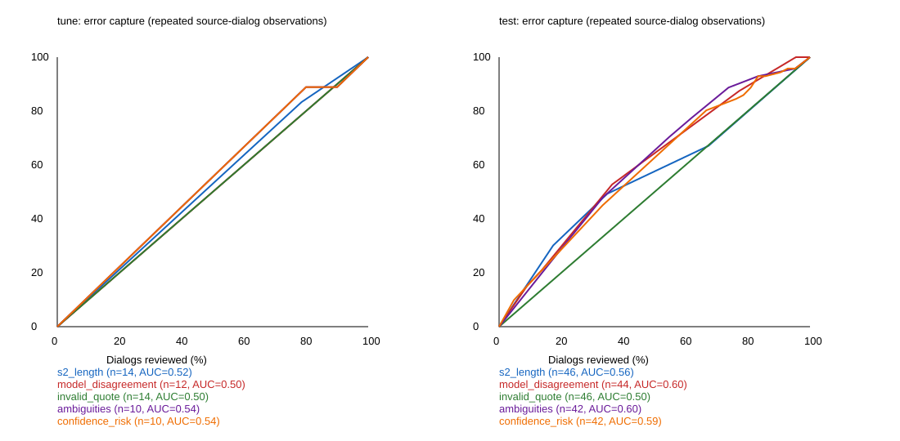

# Sprint 1 — маршрутизация к проверяющему

Наблюдений source × dialogue: 60; уникальных диалогов: 6. Эталон: dev-gold@v1.
Разбиение: {'tune': {'evaluations': 14, 'unique_dialogs': 2}, 'test': {'evaluations': 46, 'unique_dialogs': 4}}. Лучший доступный на всех наблюдениях сигнал выбран ТОЛЬКО по tune: **s2_length**.

| Сигнал | tune n / errors | tune AUC | test n / errors | test AUC | test recall @50% |
|---|---:|---:|---:|---:|---:|
| model_disagreement | 12 / 10 | 0.500 | 44 / 72 | 0.602 | 0.644 |
| invalid_quote | 14 / 12 | 0.500 | 46 / 73 | 0.500 | 0.500 |
| ambiguities | 10 / 9 | 0.539 | 42 / 71 | 0.604 | 0.654 |
| insufficient_data | 0 / 0 | — | 0 / 0 | — | — |
| low_confidence | 10 / 9 | 0.533 | 42 / 71 | 0.610 | 0.659 |
| confidence_risk | 10 / 9 | 0.539 | 42 / 71 | 0.590 | 0.627 |
| s2_call | 14 / 12 | 0.500 | 46 / 73 | 0.564 | 0.577 |
| s2_length | 14 / 12 | 0.524 | 46 / 73 | 0.558 | 0.576 |
| s2_gap | 14 / 12 | 0.476 | 46 / 73 | 0.471 | 0.370 |
| s2_duplicates | 14 / 12 | 0.500 | 46 / 73 | 0.564 | 0.577 |
| s2_system_ending | 14 / 12 | 0.524 | 46 / 73 | 0.501 | 0.502 |
| combined | 14 / 12 | 0.524 | 46 / 73 | 0.564 | 0.582 |

## Что означает кривая

Единица — завершённая оценка одного диалога одним источником. Проверка диалога предполагает просмотр всех критериев. Ошибка — несовпадение нормализованного исходного ответа с человеческой меткой, включая пропуск; это не ошибка доказательств и не обязательно большое отклонение итога. Основной анализ отделяет суждения от отбрасывания ответов строгим валидатором. Во вторичном pipeline_error_view учитывается именно answers после фильтра.
Кривая показывает долю пойманных ошибочных критериев; рядом JSON содержит долю пойманных диалогов с ошибкой. AUC=0.5 — ожидаемый случайный выбор. Для одинаковых значений порог включает весь блок; промежуточные значения линейной интерполяции — ожидание случайного выбора внутри блока, не гарантированный результат. GT не участвует в вычислении сигналов или разрешении ничьих. AUC здесь — площадь бюджетной кривой, не ROC-AUC.

## Ограничения

Наблюдения повторяют одни и те же шесть диалогов: модели и схемы не являются независимыми примерами. Сырые числа нельзя выдавать за проверку на 60 новых диалогах. Сплиты группируются по conversation_id; на test победитель не подбирается. До спринта эти диалоги уже обсуждались/изучались, поэтому это ретроспективный диагностический split, не новый независимый hold-out. Разная модель/выборка смешана с трудностью.
model_disagreement доступен только при >=2 разных модельных алиасах внутри того же прогона; sonnet2 считается повтором sonnet, а не отдельной моделью. Он требует дополнительных вызовов, поэтому не является бесплатным сигналом. У отсутствующих confidence/insufficient_data не предполагается отрицательный ответ: покрытие показано отдельно; недоступные строки не входят в кривую этого сигнала.
Признаки S2 не являются правилами качества. Длина/звонок могут узнавать конкретный сложный пример, а не обобщаемый механизм ошибок. Самооценка confidence не откалибрована. Результаты insufficient_data нельзя считать доказательством бесполезности, если поле отсутствует в V1.

## Цена и M.16 — десять контрольных чатов

V1 или hints: 10 вызовов; V5: 10+k (0<=k<=10), один пакет спорных критериев на диалог; V2: сейчас 40; панель из двух моделей V1: 20 до дополнительной проверки. Уже рассчитанные S2/цитаты/ambiguities/confidence не добавляют LLM-вызовов. При сценарии 2–4 минуты на ручной вызов V1 займёт 20–40 минут, V5 при k=3 — 26–52, V2 — 80–160. Плюс зарезервированные 15 минут на получение, экспорт, проверку и push. Это плановые сценарии, не измеренная latency. V5 при k=10 потребует 40–80 минут плюс резерв; час не гарантирован. Без репетиции максимальный безопасный ручной бюджет неизвестен.

Артефакты: analysis.json — сводка и хеши входов; rows.json — сигналы/ошибки по наблюдениям; curves.csv — все пороговые точки; routing-curves.svg — рисунок. Официальный results/ не изменяется.
